# Pecun on X: week 1

3 posts a day for 7 days. Each post's graphic is in `graphics/`; attach it to the first tweet.

- Post times that work for crypto audiences: about 9:00, 13:00 and 18:00 New York time.
- Multi-part posts are threads: post the first, then reply to it with the next.
- Rates were read from the app on 19 Nov 2026. Check them in the app on the day and update the post if they've moved.
- Partner posts say "live on Pecun" and tag the protocol. Only call it a partnership once they've agreed to one.

## Day 1

### Morning

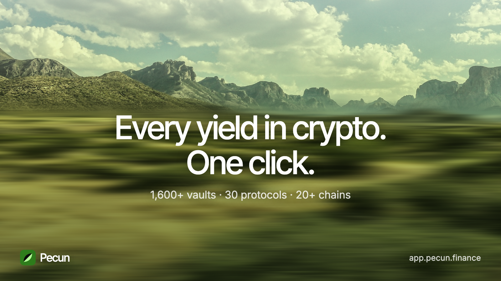

**1/4**

```text
Yield onchain isn't hard to find. It's hard to reach.

The best rate is usually on a chain you're not on, behind a bridge, a swap and a gas token you don't hold. That's why most money just sits.

Pecun is live: 1,600+ vaults, 30 protocols, 20+ chains, each one click from your wallet.
```

**2/4**

```text
Why one click matters more than the rate:

On a $100 deposit, a careless route can cost 2% to get in and 2% to get out. That's months of yield gone before you earn anything.

Pecun quotes the whole round trip first and won't run a route that costs over 0.5%.
```

**3/4**

```text
What's one click away now:

Lending: @aave @MorphoLabs @compoundfinance @eulerfinance @0xfluid @VenusProtocol @MoonwellDeFi
Fixed yield: @pendle_fi
Auto-compounding: @beefyfinance @yearnfi
Staking: @LidoFinance @Rocket_Pool @MarinadeFinance
Solana: @KaminoFinance @MeteoraAG
```

**4/4**

```text
Rates are variable and every vault has its own risks: Pecun shows them on each vault page before you press.

Stop picking a chain. Pick the vault.

app.pecun.finance
```


### Midday · partner


```text
Lending is the oldest yield in DeFi: borrowers pay interest, suppliers earn it. No token emissions needed, just demand to borrow.

@aave runs the biggest lending markets onchain, on 14 chains. On Pecun, every one of them is one click from your wallet.
```


### Evening

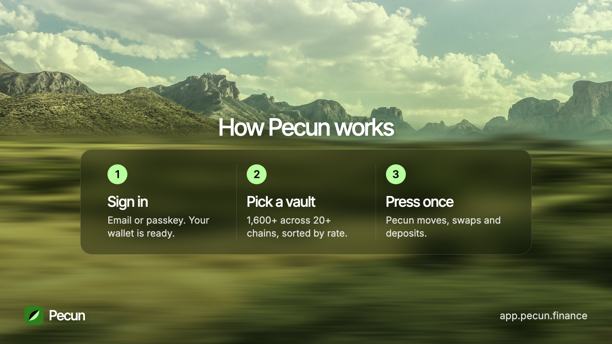

```text
The real cost of DeFi isn't the fee. It's the hour.

Find the vault, bridge, buy gas, swap, approve, deposit. Then all of it backwards to leave.

On Pecun: sign in, pick a vault, press once. Exiting is one press too.
```


## Day 2

### Morning

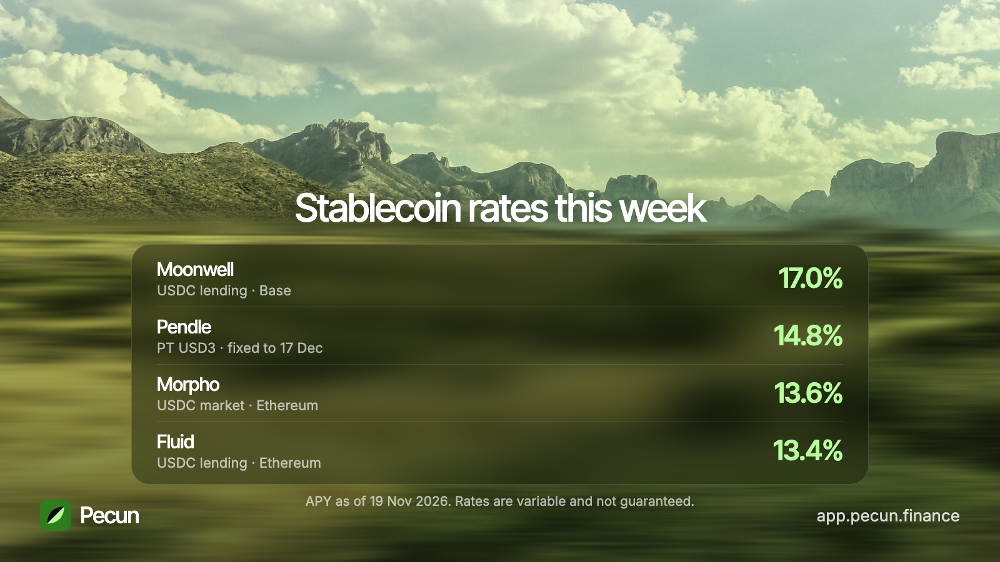

```text
APY is a speed, not a promise.

These are this week's stablecoin rates on Pecun. They will move: lending rates follow borrowing demand, and fixed rates (like Pendle's) only hold if you keep to maturity.

Compare rates, then compare exits. Rates as of 19 Nov 2026, variable, not guaranteed.
```


### Midday · partner


```text
Curators are the fund managers of DeFi, and most people have never heard of them.

On @MorphoLabs, teams like Steakhouse and Gauntlet choose which markets a vault lends into and how much risk it takes. Picking a vault is picking a curator.

680 Morpho vaults and markets, one click away on Pecun.
```


### Evening

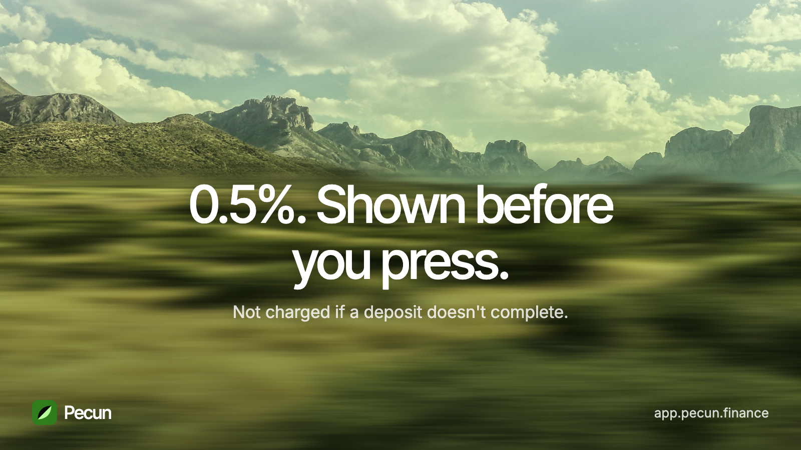

```text
A fee you can't see before you press isn't a fee. It's a surprise.

Pecun shows its 0.5% fee and the full bridge and swap cost up front, takes the fee only after your deposit lands, and charges nothing if it doesn't complete.
```


## Day 3

### Morning

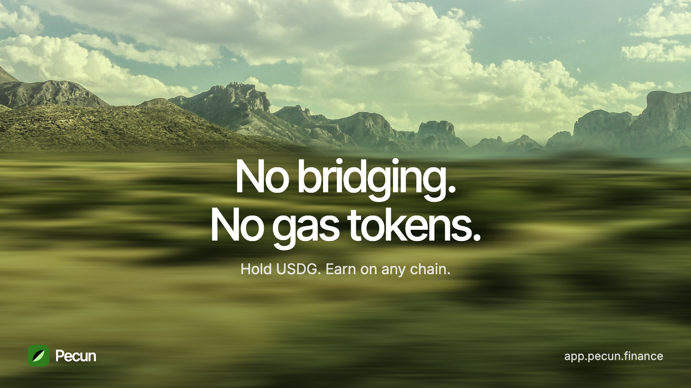

```text
"Gas token" is a UX bug, not a feature.

Nobody should have to buy ETH to earn on Ethereum, SOL to earn on Solana and SUI to earn on Sui.

On Pecun you hold USDG. The moves and the network fees on the way are handled for you.
```


### Midday · partner


```text
The chain you're on shouldn't decide what you earn.

Some of the deepest stablecoin and SOL yields live on Solana, in @KaminoFinance vaults. Most EVM users never touch them because of the new wallet, the bridge and the SOL for gas.

On Pecun they're one click from USDG.
```


### Evening


**1/2**

```text
"Just bridge it" is the most expensive sentence in crypto.
```

**2/2**

```text
Bridges and swaps carry fixed costs. On $10,000 they're noise. On $100 they can be 2% each way, more than a month of yield.

So we checked every route into and out of every vault, and left out the ones that cost more than 0.5% at $100. Shorter list, better deal.
```


## Day 4

### Morning

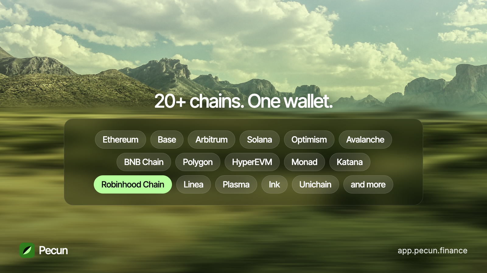

```text
Stop picking a chain, then a vault. Pick the vault.

The old way: choose a network, move money there, see what's on offer.
The better way: see every vault on 20+ chains at once, pick the best, press once.

That's Pecun.
```


### Midday · partner


```text
Fixed yield is the most underrated thing in DeFi.

With @pendle_fi you buy a PT at a discount and it's worth the full amount at maturity. The gap is a rate you lock in, like a bond. Sell early and you get that day's market price.

On Pecun it's one click from USDG.
```


### Evening

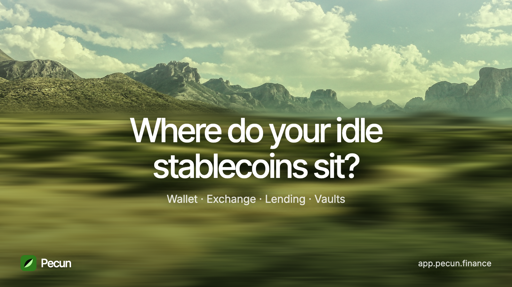

```text
Idle stablecoins aren't safe from loss. They're losing quietly.

Money that earns nothing falls behind inflation every day it sits. The question isn't whether to put it to work, it's where, and at what risk.

Pecun shows you both, one click from any vault onchain.
```


## Day 5

### Morning

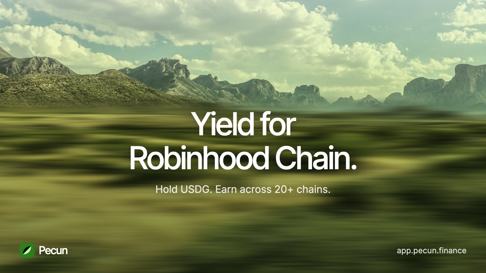

```text
Being on Robinhood Chain shouldn't mean only earning what's on Robinhood Chain.

Hold USDG. Pecun takes it to the vault you pick on any of 20+ chains, and every withdrawal comes back to USDG at home.
```


### Midday · partner


```text
Liquid staking: earn staking rewards without locking your ETH.

Stake through @LidoFinance and you get stETH, which earns while you hold it and can be sold any time. That's why it's the biggest yield product onchain.

On Pecun, stETH is one click from USDG.
```


### Evening

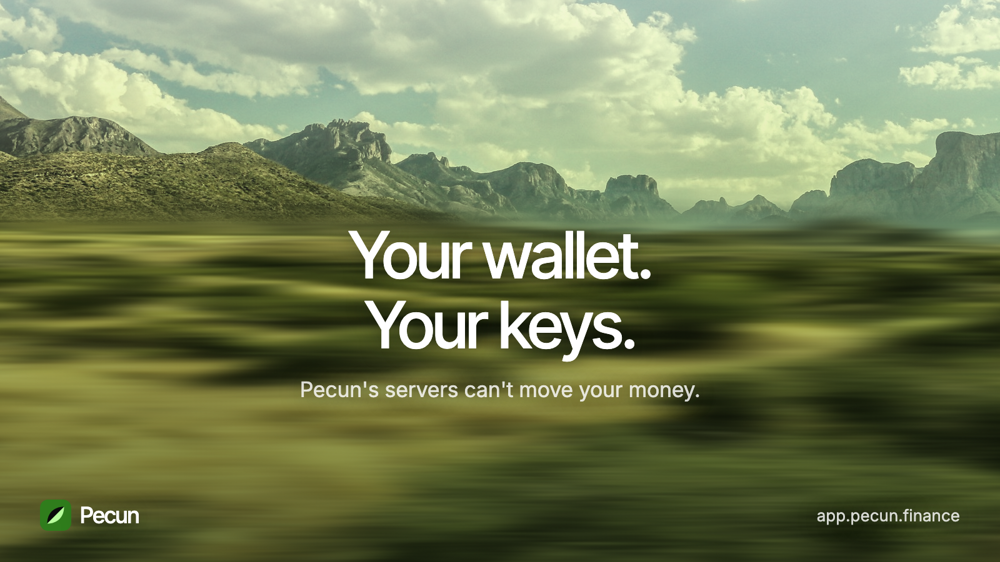

```text
"Not your keys" was never just about exchanges. It's about who can move your money.

Your Pecun wallet's keys sit in secure hardware, and only your own sign-in can approve a move. Pecun's servers can't move your funds on their own.
```


## Day 6

### Morning

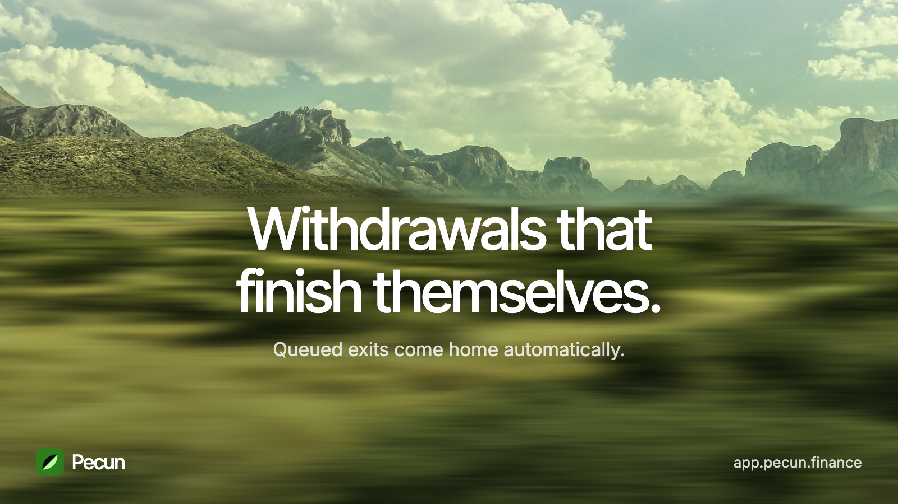

```text
Most people compare rates. Almost nobody compares exits.

Some vaults pay out instantly, some queue you for days, some lock until maturity. The exit is part of the yield.

On Pecun, queued withdrawals finish themselves: once the vault pays out, the money comes home to USDG. No second press.
```


### Midday · partner


```text
Auto-compounding is free yield people leave on the table.

Rewards that sit unclaimed earn nothing. @beefyfinance vaults claim and reinvest for you, so your earnings earn too, and there's nothing to claim, ever.

160+ Beefy vaults on 9 chains, one click away on Pecun.
```


### Evening

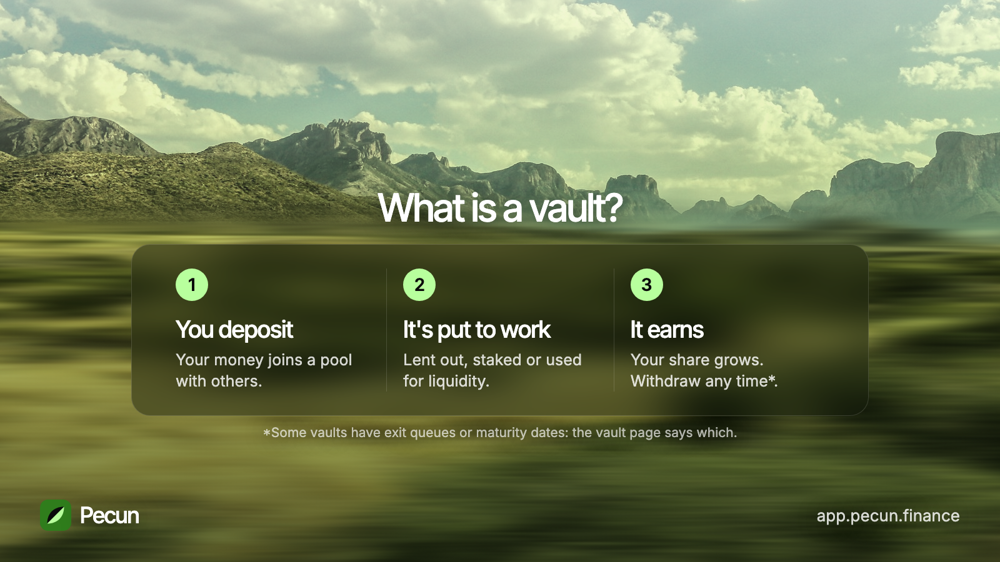

**1/2**

```text
Higher APY usually means higher risk. Here's how to tell why:
```

**2/2**

```text
A vault pools deposits and puts them to work: lent to borrowers, staked, or used as trading liquidity. Ask where the yield comes from. Borrowers? Fees? Reward tokens? Leverage?

If you can't answer, you're the yield. Every vault on Pecun says what it does and how you exit.
```


## Day 7

### Morning

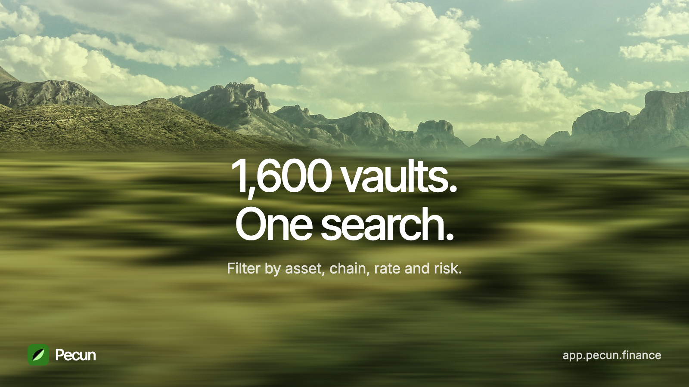

```text
The yield isn't hidden. It's scattered.

This week's best stablecoin rate might be on Base, next week on Ethereum, after that on Solana. Chasing it by hand costs more than it earns.

Pecun puts 1,600+ vaults in one list, each one click from your wallet.
```


### Midday · partner


```text
On a perp exchange, someone has to take the other side of every trade. Liquidity providers do, and earn the fees.

@GMX_IO pools on Arbitrum and Avalanche pay LPs from trading fees, with the market risk that comes with it.

On Pecun they're one click from USDG.
```


### Evening

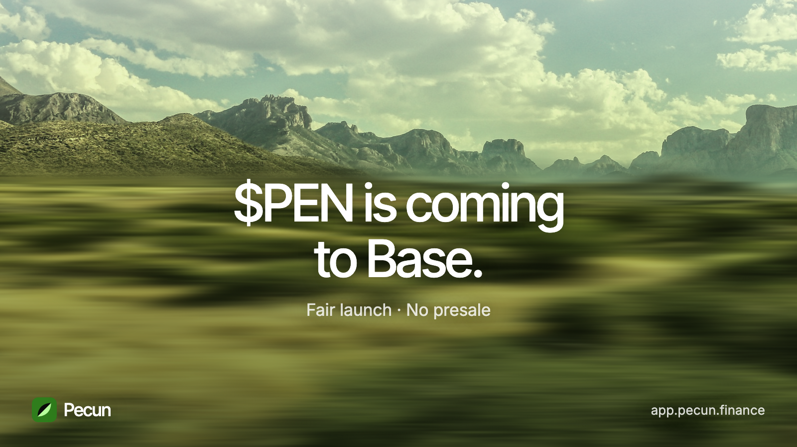

```text
Most tokens ask you to trust that value flows back to holders. $PEN puts it in a fund you can see.

$PEN launches on Base: fair launch, no presale. Terms and risks will be on docs.pecun.finance first, and the contract will only ever be posted there and here.
```

